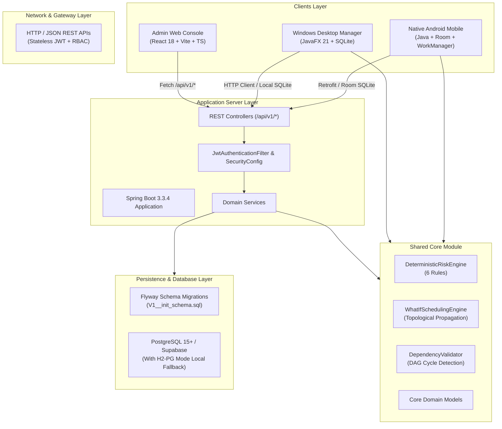

# Architecture Overview

## System Architecture Diagram

---

## Architectural Principles

1. **Shared Domain Logic**: The deterministic engines (`DeterministicRiskEngine`, `WhatIfSchedulingEngine`, `DependencyValidator`) reside in `:shared-core`, shared directly between backend, desktop, and mobile targets without logic drift.
2. **Tenant Isolation**: All database tables enforce strict workspace partitioning with composite indices on `(workspace_id, ...)` and repository checks preventing cross-tenant leakage.
3. **Offline-First Persistence**: Both Android (Room) and Desktop (SQLite JDBC) cache domain records locally, queue write operations when disconnected, and synchronize via the `SyncService` when network connectivity is established.
4. **Stateless Security**: Spring Security enforces stateless JWT token authentication with role-based method security (`@PreAuthorize("hasAnyRole(...)")`).
5. **Database Independence**: The persistence layer uses standard ANSI SQL and PostgreSQL features supported by Supabase, with automatic fallback to H2 in PostgreSQL mode for zero-configuration local development and unit testing.
