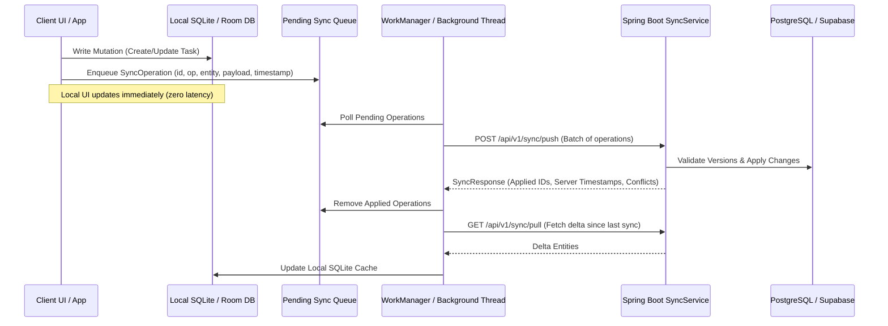

# Offline Synchronization Protocol

ProjectFlow Intelligence implements an offline-first operational model allowing desktop and mobile users to create, modify, and manage tasks and projects while disconnected from the central server.

---

## Architecture of the Sync Pipeline

---

## Idempotency & Sequencing
- Each operation generated by a client receives a globally unique `UUID` and monotonically increasing `client_sequence`.
- The server checks the `sync_operations` table to guarantee that retransmitted requests are processed exactly once.
- Operations are evaluated in creation order per entity to prevent out-of-order state transitions.
